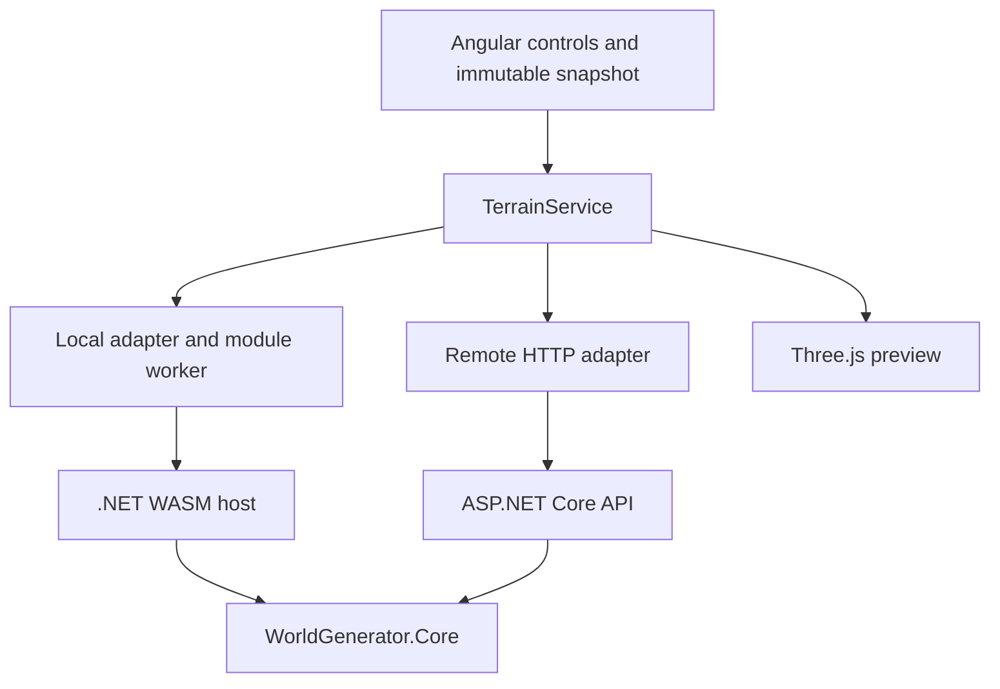

# Architecture

The application has one generator: **Diverse terrain + hydraulic erosion**, displayed with Three.js. Local WebAssembly and Remote API are execution locations for the same workload. Baseline generation, probe diagnostics, the experimental regional world, and all 2D previews have been removed. Evolution playback is a planned extension, not a current feature.

## Components

Core owns validation, deterministic noise/composition, hydraulic simulation, and biome classification. It has no JSON, HTTP, timer, DOM, or rendering dependencies. Hosts link shared transport source from `src/hosts`; no separate contracts package is needed. TypeScript handles forms, transport normalization, comparison, and visualization; it does not reproduce generation mathematics.

`TerrainGenerator.Generate` validates before allocation. Hosts use `TerrainValidator.Prepare` and its immutable `ValidatedTerrainRequest`, then time `GenerateValidated` without revalidation. Null direct requests throw `ArgumentNullException`; invalid direct requests throw `ArgumentException`.

## Terrain editor

`App` coordinates draft forms, immutable generation snapshots, revision checks and the shared operation lock. A large deferred Three.js viewport is flanked by the parameters sidebar and results/measurements sidebar. `TerrainParametersPanel` owns grouped controls and draft actions; `TerrainResultsPanel` owns result selection, the viewport, comparison and metrics; `PwaStatusPanel` uses the same root-injected lock for readiness and reload. Panels stack on smaller screens and can be collapsed using native details controls.

`terrain-parameters.ts` centralizes labels, descriptions, input steps and defaults. Mountain/warp sliders have presentation bounds, with synchronized exact numeric inputs. These bounds are UI guidance, not canonical validators; Core remains authoritative for ranges and work budgets. Random seed uses browser crypto only to select an Int32 seed. Reset and all controls modify a draft without executing the generator. Capture rejects missing/non-finite values and freezes both request levels. Nested Core error paths map to input errors.

Generation preserves prior successful maps during work or errors. Display labels distinguish captured settings from the current draft; input edits clear comparison state. Local/Remote verification remains sequential with one snapshot, and commits the pair after both complete. Revision and destruction checks discard obsolete responses; the operation lock is held until the real asynchronous call settles, including after component destruction.

One primary result is visible by default; Local/Remote selection and Compare views are explicit. Comparison views can retain results from different requests, which are labelled and flagged; numerical verification is shown only for a verified identical request. Build identity remains separate from numeric agreement. Captured parameters, versions, simulation totals and startup/display details are expandable. Individual runs are not a benchmark campaign.

Camera pose survives same-scale result replacement within a preview. Changing dimensions/height scale or recreating a preview resets framing; Reset camera restores the default request-based framing. Both comparison views use the same scale rule. Rendering and interaction pause during operations; cleanup releases observers, controls, meshes and renderer resources. Readiness is compact in the header, with visible recovery/update state and a discoverable update check. Safe reload and complete-version cache verification remain unchanged. No new frontend dependencies are introduced; the v2 ecology contract is specified below.

Playback and brush editing are not implemented. Bounded evolution capture is the next phase.

## Contracts and public surface

The sole generation endpoint is `POST /api/v1/terrains`; `GET /api/health` reports availability. Unknown `/api` routes return 404 rather than the Angular shell. The sole WASM export is `GenerateTerrainJson`, exposed as the asynchronous `generateTerrainJson` worker proxy. See [development](DEVELOPMENT.md) for a complete request.

`TerrainRequest` contains required `heightMap`, `mountainStrength`, `warpStrength`, `iterations`, `rainfall`, `evaporation`, `plainsCoverage`, `mountainCoverage`, `globalMoisture`, `seaLevel` and `algorithmVersion`. Coverage tendencies must sum to at most 1; all four new controls range 0..1. `heightMap` remains the nested composition settings contract, not a second generation mode. Its `value-noise-fbm-v1` tag identifies the noise primitive; the top-level algorithm is `diverse-landscape-v2`. Dimensions, scales, seeds, and all simulation settings must be identical for a Local/Remote comparison. Exact current equations and limits are in [LANDSCAPE_V2.md](LANDSCAPE_V2.md); [TERRAIN_WORKLOAD.md](TERRAIN_WORKLOAD.md) preserves historical v1.

The host envelope contains `result`, `simulation`, exact `parameters`, `computeMs`, `coreBuildId`, `workload = landscape-ecology-hydraulic-v2`, and `simulationVersion = hydraulic-grid-v1`, plus `executionProfile = landscape-worker-json-v2`. The result additionally contains moisture, temperature, slope, vegetationDensity and trees. The result has width, height, row-major float32 `values[y * width + x]`, numeric `biomes`, algorithm version, and `resultVersion = landscape-ecology-v2`. The new result/workload identities distinguish ecology from historical v1.

All wire members are required. Nullable wire records distinguish missing fields from zero. JSON is camelCase and case-sensitive; unknown members, numeric strings, comments, trailing commas, malformed JSON, and overflowing/non-finite numbers are rejected. Both hosts return the same `{ error, fields }` shape: `invalid_json` for transport failures or `validation` with field errors. Canonical numeric limits live only in Core. API failures return 400; all terrain responses use `Cache-Control: no-store`.

## Determinism and display

All composition and simulation passes are single-threaded in fixed order. Noise uses explicit unchecked uint hashing, quintic interpolation and double intermediates; final heights are float32. Each call owns its arrays. The independent Python fixture and Core tests freeze the selected terrain arithmetic.

Biome IDs are Ocean=0, Grassland=1, Forest=2, DryGrassland=3 and Rock=4. Boundary-connected sea classification uses an explicit relative sea level; low interior depressions remain dry. Moisture, normalized warmth and slope influence biomes; trees require eligible forest corners. Core returns full environment/density arrays and bounded deterministic tree instances. TypeScript only normalizes, compares and renders the results. [LANDSCAPE_V2.md](LANDSCAPE_V2.md) freezes equations, constants, units and selection rules.

`TerrainService` validates the entire host response, echoed settings, versions, work counters, finite heights and IDs before copying to typed arrays. Comparison examines every height with `abs(a-b) <= 1e-6 + 1e-5 * max(abs(a), abs(b))`, and compares every biome ID and tree cell index exactly. All new float fields, instance transforms and simulation totals are compared using the same numeric tolerance; separate environment and vegetation discrepancy counts are reported. Build identity is reported separately from numeric agreement.

Three.js builds a mesh directly from Core heights and colors it from Core biome IDs. Both views use the same request scale. Orbit, zoom and pan remain. Rendering pauses while an operation holds the shared lock. Tree positions are computed by Core on the exact terrain triangles. Two shared low-poly instanced meshes render all returned trees per viewport, without renderer-side placement or ecological decisions. The cap is 16384 computed trees; density remains available over all samples. Geometry, instanced meshes, materials, controls, observers and renderer resources are disposed on replacement/destruction. WebGL failures show a presentation error while numerical results remain available. No 2D fallback is included.

## Timing, worker and build identity

One module worker owns one .NET runtime per document. All callers share initialization and the RPC proxy (`worker-rpc-v1`), with correlation IDs and rejection of pending requests on worker failure. A later attempt may initialize again. Worker startup and runtime initialization are separate from `computeMs`; promises alone would not move computation off the UI thread.

Core time includes composition, simulation allocation and all steps, summaries, conversion, environment/ocean derivation, biome classification and bounded vegetation selection. Erosion and its closed boundary rules are unchanged; static ocean colors do not change the transient erosion-water model. Parsing/preparation, JSON, worker messages or HTTP, client normalization, comparison and rendering are excluded. Browser `requestMs` ends after response validation/normalization. `requestMs - computeMs` is combined overhead, not pure network latency. Display CPU setup/first submission is separate and is not GPU completion.

`HostBuildIdentity.targets` generates `coreBuildId` from Git HEAD and modifications to `global.json`, `src/core`, and `src/hosts`. Dirty inputs add `-dirty`; failed Git detection yields `unversioned`. Matching dirty/unversioned IDs do not prove compatibility. An explicit build property may provide a release identity; assembly ModuleVersionId is not used.

## PWA and extension boundary

Angular service worker prefetches the complete versioned application, deferred Three.js and WASM/worker assets. The generated catalog is tied to the cached index and manifest hashes. Readiness verifies one complete matching version cache and a tiny zero-step terrain computation. API results are never cached. Safe updates require reload while idle; readiness is verified again in the new document.

Preserve the selected generator's appearance and equations when adding evolution capture. Capturing snapshots must not change final values, must have bounded memory, and must be measured as a distinct workload. Future climate and hydrology need explicit versions and must not reintroduce automatic filling of every depression. See the [roadmap](IMPLEMENTATION_PLAN.md).
