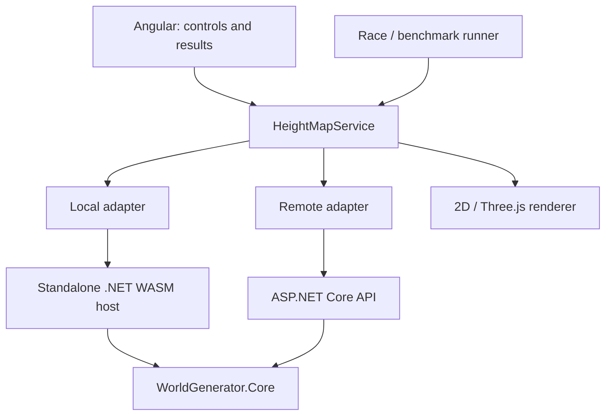

# Architecture

**Status:** Phases 0–2 are implemented: the shared deterministic C# core, WASM/API heightmap hosts, and Angular heightmap MVP provide parameter controls, Local/Remote execution, sequential equivalence checks, timings, and Canvas 2D previews. The single-origin production build and browser behavior are verified. Probe checks remain available in collapsed diagnostics. PWA/offline, 3D/biomes, and Architecture Race remain planned. See [development instructions](DEVELOPMENT.md) for commands and verification details. The [Project Brief](PROJECT_BRIEF.md) defines the required scope.

## 1. Components and dependencies

One monorepo, one Angular application, two thin execution hosts, and one algorithm library. Additional Domain/Application/Infrastructure layers are unnecessary for this scope.



The arrows to Core represent dependencies on the same C# source project. The browser and server run separate instances of the execution environment.

Current project structure:

```text
src/
  client/          Angular, adapters, UI, visualization, runner
  core/            WorldGenerator.Core: models, validation, algorithms
  hosts/           shared transport, JSON, build identity, GenerationResponse
  wasm/            WorldGenerator.Wasm: JS exports, runtime startup
  api/             WorldGenerator.Api: HTTP endpoints
tests/
  core/            determinism, validation, reference outputs
  api/             HTTP and host serialization contracts
  browser/         WASM/API parity, production and offline smoke tests
scripts/           only the necessary build/packaging scripts
docs/
```

A separate `Contracts` project is not needed yet: pure input and output models belong in Core. Transport envelopes containing timings belong to the hosts; contract tests verify their consistency.

| Component | Responsibility |
| --- | --- |
| Core | Deterministic generator, canonical validation, models, algorithm version; biome classification later |
| WASM host | One-time runtime initialization, batched JS/.NET calls, data adaptation, Core timer |
| API | A generation request, HTTP input validation, Core invocation, timer, response |
| HeightMapService | Adapter selection, input snapshot, request state, browser timings, common result format |
| Renderer | Map → pixels or mesh, palette, camera, Three.js resource cleanup |
| Runner | Execution order, output comparison, statistics, and export |

Core has no dependencies on HTTP, JSON, the DOM, Three.js, or timers. TypeScript may convert formats, build meshes, and calculate comparison statistics; the generation algorithm and biome rules remain in C#.

## 2. Contract v1

The request and result contracts and the Core generator are implemented in `WorldGenerator.Core`. Host integration is implemented through the WASM export `GenerateHeightMapJson` and the API endpoint `POST /api/v1/heightmaps`; the 2D MVP is the next Phase 2 step. Tests establish the contract before measurements begin.

```json
{
  "seed": 42,
  "width": 256,
  "height": 256,
  "noiseScale": 0.03,
  "octaves": 4,
  "heightMultiplier": 30.0,
  "algorithmVersion": "value-noise-fbm-v1"
}
```

| Field | Type and v1 rule |
| --- | --- |
| `seed` | C# `int` / signed 32-bit integer; negative values are allowed |
| `width`, `height` | Integers from 2 to 512; also require `width × height ≤ 262144`, checked before allocation |
| `noiseScale` | Finite number from 0.0001 to 1; sampling frequency per cell |
| `octaves` | Integer from 1 to 8 |
| `heightMultiplier` | Finite number from 0 to 1000; height scale in world units |
| `algorithmVersion` | Exactly `value-noise-fbm-v1`, compared with ordinal, case-sensitive equality |

These are initial limits, not a verified memory or performance budget. The PoC or profiling may require lowering them equally for both modes. Raising the limits is a separate decision made before a new measurement campaign.

`HeightMapRequest` is an immutable positional record whose constructor requires every field. `HeightMapLimits` exposes the named v1 constants (including `SupportedAlgorithmVersion = "value-noise-fbm-v1"`). `HeightMapValidator.Validate` returns every applicable structured `ValidationError` without rounding, clamping, or substituting defaults; `IsValid` is a convenience wrapper. A null request produces one `request.required` error rather than an exception. Errors are ordered deterministically by request field: `width`, `height`, cell count, `noiseScale`, `octaves`, `heightMultiplier`, `algorithmVersion`.

`HeightMapValidator.Prepare` wraps validation in a `HeightMapPreparation` result. A valid preparation contains a `ValidatedHeightMapRequest`, an immutable snapshot with an internal constructor and no public mutation path, so a host can validate once and generate without revalidating mutable input. Generation APIs are `Generate(HeightMapRequest?)`, which validates and preserves the existing exception contract, and `GenerateValidated(ValidatedHeightMapRequest)`, which performs generation only. Hosts must use `Prepare`/`GenerateValidated` so validation is authoritative and not included in generation timing.

| Error code | Meaning |
| --- | --- |
| `request.required` | The request object is null |
| `field.required` | A required field is null or empty (currently the algorithm version) |
| `value.out_of_range` | A finite value is outside its inclusive range |
| `value.not_finite` | A floating-point value is NaN or an infinity |
| `cell_count.exceeded` | `width × height` exceeds 262144, using overflow-safe arithmetic |
| `algorithm_version.unsupported` | The version is nonempty but not exactly `value-noise-fbm-v1` |

Hosts must call this validator rather than duplicate the limits or comparison rules. Transport parsing and detection of missing wire fields remain host concerns and must not turn omitted fields into valid default values. The shared host path parses a nullable wire request, reports missing fields in canonical order, then calls Core `Prepare`; it does not create a `HeightMapRequest` with substituted defaults. `HeightMapResult` contains `width`, `height`, `values` (`float[]`), and `algorithmVersion`.

```text
HeightMapResult:
  width, height: int
  values: float[]                # IEEE 754 float32; heights 0…heightMultiplier
  algorithmVersion: string

GenerationResponse:
  result: HeightMapResult
  computeMs: double             # GenerateValidated time only, measured in this host
  coreBuildId: string           # build-time Git revision shared by WASM and API
  workload: "heightmap"         # scope of the measured computation
```

Data is flattened as `values[y * width + x]`, with `x` increasing within each row. The length equals `width × height`, and all values are finite. Core has already scaled the heights; the renderer must not apply the multiplier a second time.

`GenerationResponse` is a host transport envelope, not a Core model: it belongs outside `WorldGenerator.Core` because it carries host measurement and build metadata. It is implemented as `src/hosts/GenerationResponse.cs`, a host-owned source file linked into both `WorldGenerator.Wasm` and `WorldGenerator.Api`; no separate project or package is required. The positional record contains `Result`, `ComputeMs`, and `CoreBuildId`, while `Workload` is a getter-only property fixed to `"heightmap"`. The WASM host registers the envelope in its JSON source-generation context, and both hosts serialize the camelCase names `result`, `computeMs`, `coreBuildId`, and `workload`. `computeMs` measures generation after parsing and preparation and excludes serialization, interop, transport, and rendering. `coreBuildId` identifies the shared Core revision used by each host, not the host build. `workload` is metadata describing the measured computation, not a user-controlled generation parameter.

Shared transport behavior lives in `src/hosts`: `HeightMapWireRequest` distinguishes missing fields from zero values, `HeightMapTransport` parses and prepares the request, and `HostJson` applies the same strict JSON options to both hosts. JSON is camelCase, case-sensitive, rejects unknown members, numeric strings, comments, trailing commas, and non-finite numbers. The API uses `DefaultJsonTypeInfoResolver` for internal requests; the WASM host uses the source-generated `HostJsonContext`. Transport failures use the shared `{ "error", "fields" }` envelope: `invalid_json` means malformed or incompatible JSON, and `validation` contains canonical field errors. `error` is a category and `fields` maps request field names to details. API failures return HTTP 400 and successful or failed generation responses use `Cache-Control: no-store`.

`CoreBuildId` is generated at build time by `src/hosts/HostBuildIdentity.targets` from repository HEAD, checking `global.json`, `src/core`, and `src/hosts` for modifications. The normal value is `git:<commit-abbreviation>` (at least 12 hexadecimal characters), with a `-dirty` suffix when those inputs are modified. Both Git commands must succeed, and the revision must match the SHA format. Missing Git, a missing repository, an invalid revision, or a failed status check produces `unversioned`, which is not valid benchmark identity. Git diagnostics are never used as identity or dirty-state data after a failed command. An explicit `CoreBuildId` MSBuild property overrides auto-detection; `CoreBuildIdGitExecutable` optionally selects the Git executable. The build ID is deliberately not an assembly `ModuleVersionId`.

Transport overflow such as `1e400` or `-1e400` in either double field returns `invalid_json` before Core preparation. A finite representable number outside the parameter limits still returns `validation`. Direct Core callers retain canonical non-finite validation.

In phase 3B, the result gains a `biomeIds` array in the same order: `byte[]` in C#, a JSON array of integer codes at the boundary, and `Uint8Array` in the client. Classification belongs to Core and is included in `computeMs` in both modes; `workload` becomes `heightmap+biomes`. The codes, thresholds, and a new version of the extended contract/algorithm must be defined by that phase. The final campaign uses this same workload in both modes.

All request fields are required. Invalid values are neither rounded nor replaced with defaults. The UI provides guidance, but Core performs the same authoritative validation in both modes. Both hosts reject unexpected fields and invalid types at the transport boundary. Missing numeric fields must not silently become C# zeros, and zero is accepted only where the canonical range permits it, such as `heightMultiplier`. The native API and WASM export tests verify that both hosts produce the same error categories and field errors.

## 3. Generator and determinism

`HeightMapGenerator.Generate` implements `value-noise-fbm-v1` synchronously on one thread and returns independent storage for each call. It validates before allocating output and throws `ArgumentNullException` for a null request or `ArgumentException` with parameter name `request` for invalid input. `GenerateValidated` accepts only an already prepared request and performs the generator work without validation. This preserves the public exception contract while allowing hosts to start `computeMs` after transport parsing and Core preparation and immediately before `GenerateValidated`; a timer around validating `Generate` would include validation and is not the measurement boundary.

The algorithm is fixed as follows:

- Reinterpret the signed seed as `uint` using an unchecked conversion and use the same seed for every octave.
- Start with frequency `1.0` and amplitude `1.0`; use `lacunarity = 2` and `persistence = 0.5`. Process octaves in ascending order.
- For each cell in row-major order, sample `sampleX = x * noiseScale * frequency` and `sampleY = y * noiseScale * frequency`.
- Select the lattice cell with `Math.Floor` for both coordinates. For each fractional coordinate `t`, apply quintic smoothing: `t * t * t * (t * (t * 6 - 15) + 10)`.
- Interpolate with `Lerp(a, b, t) = a + (b - a) * t`, along x first and then along y.
- Hash integer lattice coordinates with explicit `uint` wraparound arithmetic:

```csharp
var hash = unchecked((uint)x * 0x8DA6B343u);
hash = unchecked(hash + (uint)y * 0xD8163841u);
hash = unchecked(hash + seed * 0xCB1AB31Fu);
hash ^= hash >> 16;
hash = unchecked(hash * 0x7FEB352Du);
hash ^= hash >> 15;
hash = unchecked(hash * 0x846CA68Bu);
hash ^= hash >> 16;
return hash * (1.0 / 4_294_967_296.0);
```

- For each octave, accumulate `noise * amplitude` and the amplitude sum. Then multiply frequency by `2` and amplitude by `0.5` for the next octave.
- Normalize with `Math.Clamp(sum / amplitudeSum, 0.0, 1.0)` and return `(float)(normalized * heightMultiplier)`. Do not normalize using the generated map's minimum and maximum.
- Use `double` for intermediates and an explicit cast to `float` for final heights.

Numerical tolerance and full-array comparison are described in the [measurement protocol](BENCHMARKING.md). Changes to formulas or biome rules require a new version; build changes are recorded separately using `coreBuildId`.

## 4. Execution boundaries and transport format

The initial baseline is `json-v1`: one call for the entire map. The WASM export accepts a JSON request string and returns a JSON response string; the API accepts and returns JSON through `POST /api/v1/heightmaps`. Both paths use the same JSON rules and Core models. This is a deliberately simple starting point, and its overhead is included in the research results.

Adapters convert `values` to `Float32Array` and validate the contract. Parsing, copying, and result validation are included in adapter time, but excluded from `computeMs`. The UI, Race, and renderer receive the same result type regardless of mode.

For the PoC, begin with an exact integer scalar, then an array through the same batched path. Do not assume that an arbitrary C# DTO automatically supports `[JSExport]`: check supported types and marshalling against the [interop documentation](https://learn.microsoft.com/en-us/aspnet/core/client-side/dotnet-interop/?view=aspnetcore-10.0).

Typed-array interop and binary HTTP remain possible changes after JSON overhead has been measured. Do not mix formats within one baseline campaign; changing the representation requires a new measurement profile. Record HTTP compression and its settings as part of the experimental conditions.

The API returns `400` with an error code and field errors for invalid input; an unexpected failure returns `500`. Local maps its errors to the same application error codes. Network failures and timeouts are reported separately and do not trigger a hidden fallback to Local.

## 5. Angular, UI, and lifecycle

- Use standalone Angular components, ordinary services, and local state; a global state-management library is unnecessary for the first version.
- Load WASM on the first Local run, then reuse a single runtime. Initialization has a separate status and timer; failed initialization can be retried without creating parallel runtimes.
- Allow only one active generation request at a time. Copy parameters before execution, block repeated submissions, and associate each result with its input snapshot.
- Race invokes both adapters sequentially with the same snapshot and displays the maps after the pair completes. Different `coreBuildId`, versions, or `workload` values mark the comparison as incompatible.
- Main-thread WASM can block the UI; a `Promise` alone does not prevent this. Display the loading state before the synchronous call. Limit baseline dimensions; do not promise progress updates or immediate cancellation of Core.
- Cancelling the HTTP wait does not guarantee that server computation stops. Preserve failed runs and ensure the previous computation has finished before the next measurement.
- Three.js reuses or disposes of geometry/materials; continuous animation stops during measurement series. Geometry and palettes are identical for Local and Remote.

A Web Worker is an optional future execution change, not a required MVP dependency. If a supported size blocks the UI for too long, first lower the limit and document the restriction.

### Implemented Angular heightmap MVP

`HeightMapService.local` and `.remote` use the existing WASM runtime and HTTP endpoint. Both pass responses through `heightmap.contract.ts`, which checks the envelope, request dimensions/version, workload, timings, identity, and every height before returning independent `Float32Array` storage. Structured host errors are distinguished from protocol and availability failures. Canonical parameter validation remains in Core; the form only rejects empty or unparseable numbers and provides HTML input guidance.

`App` captures a frozen request and uses one operation lock across heightmap actions and `ProbeDiagnostics`. Changed inputs invalidate comparison state; obsolete asynchronous results are discarded. Existing maps retain their original parameter labels. The Local path permits a browser frame before synchronous computation; it can still block the main thread.

“Verify equivalence” runs Local then Remote using one snapshot and renders after the pair. It compares every height with the documented tolerance, reports maximum/mean absolute error and mismatch count, and distinguishes numerical agreement from build compatibility. Different IDs are incompatible; matching dirty/unversioned IDs remain unverifiable. This is a correctness check without repeated trials, winner rankings, or performance charts.

`HeightMapPreview` builds row-major grayscale Canvas 2D pixels on the CPU. Both maps use zero as black and the captured height multiplier as white, with an explicit zero-height case. It does not normalize each map by its own extrema or modify heights. `computeMs` comes from the host; browser `requestMs` ends after decoding and normalization, before comparison/rendering. Runtime initialization is displayed separately.

## 6. Deployment and offline support

The initial deployment uses one origin: static Angular and the WASM bundle alongside `/api`. During development, the Angular proxy forwards `/api` to ASP.NET. SSR, a CDN, and a separate gateway are unnecessary.

The standalone .NET host uses its own published assets and `[JSExport]`; the PoC verifies the working template, workload, JS loader, and paths for the selected SDK. Microsoft describes [running .NET from JavaScript without Blazor and deploying the publish output](https://learn.microsoft.com/en-us/aspnet/core/client-side/dotnet-interop/wasm-browser-app?view=aspnetcore-10.0). Do not mix `.csproj` examples from different SDK versions.

Production build order:

1. Publish the WASM host in Release mode.
2. Copy the entire required publish bundle into a dedicated Angular assets directory, such as `/wasm/`, preserving relative paths.
3. Build Angular; once PWA support is added, generate the service-worker manifest with the WASM assets already included.
4. Deploy the Angular output and API; verify MIME types, loader URLs, and that missing runtime files do not receive the SPA fallback.

Once PWA support is enabled, a dedicated asset group caches the required `/wasm/**` files alongside the application shell using `prefetch`. The resources must enter the manifest during the Angular build; the rules are described in the [Angular service-worker configuration](https://angular.dev/ecosystem/service-workers/config). Prefetch caches files but does not initialize the .NET runtime.

Neither the service worker nor the server caches API responses; generation responses use `Cache-Control: no-store`. Offline behavior must not present an old response as a new Remote computation. All required fonts and modules are also local assets.

Test the production build over HTTPS or localhost, as described in the [Angular PWA setup](https://angular.dev/ecosystem/service-workers/getting-started). Confirm offline readiness after cache installation and a successful Local check, rather than relying on `navigator.onLine`. The complete reload and new-seed scenario is in [BENCHMARKING.md](BENCHMARKING.md).

Angular and WASM assets are updated as one version. Activate a new version between runs with a reload, not during an experiment. The API may already have a different revision; the `coreBuildId` check must detect this.

## 7. Decisions verified by the PoC

| Decision | Acceptance condition |
| --- | --- |
| Toolchain versions | Supported stable .NET SDK, matching WASM tooling/template, compatible Angular/Node/TypeScript; exact versions in project files and project documentation |
| Local execution | Scalar, array, and heightmap JSON work through the standalone host; repeated calls reuse the existing runtime |
| Packaging | Release publish output loads from static hosting without dev-server dependencies |
| Heightmap hosts | Published WASM and API use the same strict JSON contract, error categories, build ID, and deterministic result |
| Baseline | JSON transfers batched data correctly; startup overhead and computation are measured separately |

Check Angular compatibility with Node/TypeScript against the [official table](https://angular.dev/reference/versions). Do not add dependencies for workers, AOT, persistence, or adaptive selection without a separate request. Phases and verification criteria are in the [roadmap](IMPLEMENTATION_PLAN.md).
