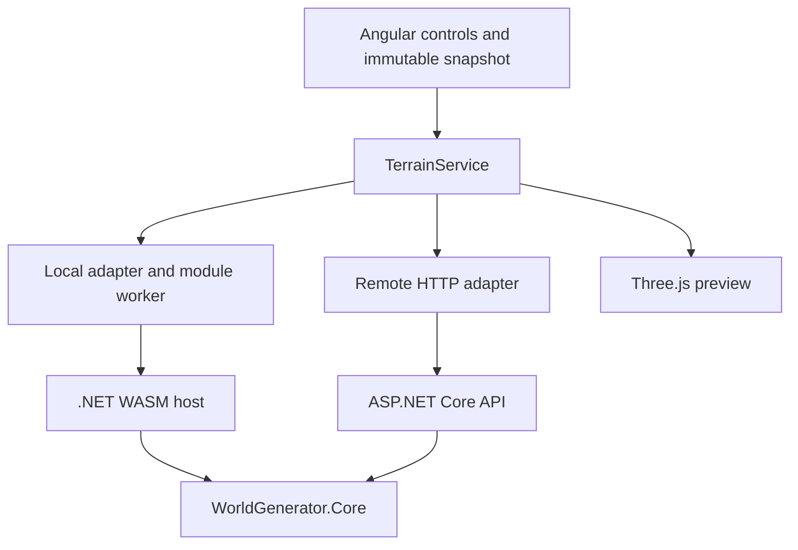

# Architecture

The application has one generator: **Diverse terrain + hydraulic erosion**, displayed with Three.js. Local WebAssembly and Remote API are execution locations for the same workload. Baseline generation, probe diagnostics, the experimental regional world, and all 2D previews have been removed. Evolution playback is a planned extension, not a current feature.

## Components

Core owns validation, deterministic noise/composition, hydraulic simulation, and biome classification. It has no JSON, HTTP, timer, DOM, or rendering dependencies. Hosts link shared transport source from `src/hosts`; no separate contracts package is needed. TypeScript handles forms, transport normalization, comparison, and visualization; it does not reproduce generation mathematics.

`TerrainGenerator.Generate` validates before allocation. Hosts use `TerrainValidator.Prepare` and its immutable `ValidatedTerrainRequest`, then time `GenerateValidated` without revalidation. Null direct requests throw `ArgumentNullException`; invalid direct requests throw `ArgumentException`.

## Terrain editor

`App` coordinates draft forms, immutable generation snapshots, revision checks and the shared operation lock. A large deferred Three.js viewport is flanked by the parameters sidebar and results/measurements sidebar. `TerrainParametersPanel` owns grouped controls and draft actions; `TerrainResultsPanel` owns result selection, the viewport, comparison and metrics; `PwaStatusPanel` uses the same root-injected lock for readiness and reload. Panels stack on smaller screens and can be collapsed using native details controls.

`terrain/editor/parameter-definitions.ts` centralizes labels, descriptions and input steps; pure `terrain/data/terrain-defaults.ts` supplies initial values to forms and readiness checks. Mountain/warp sliders have presentation bounds, with synchronized exact numeric inputs. These bounds are UI guidance, not canonical validators; Core remains authoritative for ranges and work budgets. Random seed uses browser crypto only to select an Int32 seed. Reset and all controls modify a draft without executing the generator. Capture rejects missing/non-finite values and freezes both request levels. Nested Core error paths map to input errors.

Generation preserves prior successful maps during work or errors. Display labels distinguish captured settings from the current draft; input edits clear comparison state. Local/Remote verification remains sequential with one snapshot, and commits the pair after both complete. Revision and destruction checks discard obsolete responses; the operation lock is held until the real asynchronous call settles, including after component destruction.

One primary result is visible by default; Local/Remote selection and Compare views are explicit. Comparison views can retain results from different requests, which are labelled and flagged; numerical verification is shown only for a verified identical request. Build identity remains separate from numeric agreement. Captured parameters, versions, simulation totals and startup/display details are expandable. Individual runs are not a benchmark campaign.

Camera pose survives same-scale result replacement within a preview. Changing dimensions/height scale or recreating a preview resets framing; Reset camera restores the default request-based framing. Both comparison views use the same scale rule. Rendering and interaction pause during operations; cleanup releases observers, controls, meshes and renderer resources. Readiness is compact in the header, with visible recovery/update state and a discoverable update check. Safe reload and complete-version cache verification remain unchanged. No new frontend dependencies are introduced; the v8 result contract is specified below.

Playback and brush editing are not implemented. Lighting, shadows and atmosphere are implemented as a presentation layer; bounded evolution capture remains later work.

## Contracts and public surface

The sole generation endpoint is `POST /api/v1/terrains`; `GET /api/health` reports availability. Unknown `/api` routes return 404 rather than the Angular shell. The sole WASM export is `GenerateTerrainJson`, exposed as the asynchronous `generateTerrainJson` worker proxy. See [development](DEVELOPMENT.md) for a complete request.

`TerrainRequest` contains required `heightMap`, `mountainStrength`, `warpStrength`, `iterations`, `rainfall`, `evaporation`, `plainsCoverage`, `mountainCoverage`, `globalMoisture`, `seaLevel`, `globalWarmth`, `vegetationDensity`, `landformRegionScale` and `algorithmVersion`. Coverage tendencies must sum to at most 1; coverage, moisture, sea level, warmth and vegetation density range 0..1; region scale ranges .25..4. `heightMap` remains the nested composition settings contract, not a second generation mode. Its `value-noise-fbm-v1` tag identifies the noise primitive; the top-level algorithm is `diverse-landscape-v7`. Dimensions, scales, seeds, and all simulation settings must be identical for a Local/Remote comparison. Historical height and unchanged climate equations are in [LANDSCAPE_V3.md](specs/LANDSCAPE_V3.md), current vegetation in [VEGETATION_STRUCTURE_V1.md](specs/VEGETATION_STRUCTURE_V1.md), and coverage in [SURFACE_TRANSITIONS_V1.md](specs/SURFACE_TRANSITIONS_V1.md); [TERRAIN_WORKLOAD.md](specs/TERRAIN_WORKLOAD.md) preserves historical v1.

The host envelope contains `result`, `simulation`, exact `parameters`, `computeMs`, `coreBuildId`, `workload = landscape-ecology-hydraulic-v8`, and `simulationVersion = hydraulic-grid-v1`, plus `executionProfile = landscape-worker-json-v8`. The result additionally contains moisture, temperature, slope, vegetationDensity, trees and required surfaceWeights and rocks. The result has width, height, row-major float32 `values[y * width + x]`, numeric `biomes`, algorithm version, and `resultVersion = landscape-ecology-v8`. The new result/workload identities distinguish ecology from historical v1.

All wire members are required. Nullable wire records distinguish missing fields from zero. JSON is camelCase and case-sensitive; unknown members, numeric strings, comments, trailing commas, malformed JSON, and overflowing/non-finite numbers are rejected. Both hosts return the same `{ error, fields }` shape: `invalid_json` for transport failures or `validation` with field errors. Canonical numeric limits live only in Core. API failures return 400; all terrain responses use `Cache-Control: no-store`.

## Determinism and display

All composition and simulation passes are single-threaded in fixed order. Noise uses explicit unchecked uint hashing, quintic interpolation and double intermediates; final heights are float32. Each call owns its arrays. The independent Python fixture and Core tests freeze the selected terrain arithmetic.

Biome IDs are Ocean=0, Grassland=1, BroadleafForest=2, DryGrassland=3, Rock=4, ConiferForest=5, Savanna=6, Tundra=7 and SnowHighlands=8. Tree kinds are Broadleaf=0, Conifer=1 and Savanna=2. Boundary-connected sea classification uses an explicit relative sea level; low interior depressions remain dry. Moisture, normalized warmth and slope influence biomes; trees require four eligible corners with the same tree category. Core returns full environment/density arrays and bounded deterministic tree instances. TypeScript only normalizes, compares and renders the results. [LANDSCAPE_V3.md](specs/LANDSCAPE_V3.md) freezes equations, constants, units and selection rules.

`TerrainService` validates the entire host response, echoed settings, versions, work counters, finite heights and IDs before copying to typed arrays. Comparison examines every height with `abs(a-b) <= 1e-6 + 1e-5 * max(abs(a), abs(b))`, and compares every biome ID, tree kind, variant and tree cell index exactly. All float fields, instance transforms and simulation totals are compared using the same numeric tolerance; separate environment, vegetation, coverage and rock discrepancy counts are reported. Build identity is reported separately from numeric agreement.

Three.js builds a mesh directly from Core heights and blends its surface colors from Core coverage weights. Both views use the same request scale. Orbit, zoom and pan remain. Rendering pauses while an operation holds the shared lock. Tree positions are computed by Core on the exact terrain triangles. Two shared low-poly instanced meshes per nonempty kind/variant pair render all returned trees, at most twelve vegetation meshes per viewport, without renderer-side placement or ecological decisions. The cap is 16384 computed trees; density remains available over all samples. Geometry, instanced meshes, materials, controls, observers and renderer resources are disposed on replacement/destruction. WebGL failures show a presentation error while numerical results remain available. No 2D fallback is included.

## Vegetation structure

The vegetation policy adds deterministic Core-owned groves, clearings and same-kind edge attenuation. Stage 6 changes their height inputs while retaining the ecological equations. One four-connected distance pass uses two temporary int[N] arrays. Density is updated in place, with the user multiplier last; masks, candidate hashes and variants never depend on that multiplier. Candidate sets are monotonic before the 16384 cap; fixed priorities can replace entries after capping, and retained transforms remain stable.

Every tree record now has eight required members, including numeric variant (Small=0, Mature=1). Core selects it using an independent cell/seed hash, not biological age. The client rejects legacy/malformed variants and compares variants exactly. The renderer maps kind/variant to fixed low-poly proportions/colors and renders every returned record, with no PRNG or per-tree materials. See [VEGETATION_STRUCTURE_V1.md](specs/VEGETATION_STRUCTURE_V1.md) for frozen salts, distances, operation order and memory budgets. Historical density/placement references and v3/v4 field fingerprints remain test-only.

## Surface material boundary

Core first derives the frozen base surface-v1 vector from final heights/environment. Trees and rocks consume the existing ecological fields and base coverage. Only after placement, CoastalSurfaces reuses the authoritative ocean mask to derive bounded inland distance and blend final coverage in place. This ordering preserves every non-coverage value and instance exactly. Land below/equal sea in a disconnected depression receives no coastal influence. See [COASTAL_SURFACES_V1.md](specs/COASTAL_SURFACES_V1.md) for distance, elevation/climate/slope masks, snow precedence and arithmetic; [SURFACE_TRANSITIONS_V1.md](specs/SURFACE_TRANSITIONS_V1.md) preserves the base policy.

The required five-channel float32 surfaceWeights array stays Grass/Soil/Sand/Rock/Snow. Land vectors sum to one within 1e-6; Ocean vectors stay zero. Sand is now an active numeric land channel. Snow bits and coverage beyond influence are preserved. Strict decoding still rejects malformed/nonfinite/unbounded/unnormalized vectors, and full comparison checks every channel.

Lambert shader revision terrain-surface-coverage-v2 blends supplied colors and five local grayscale detail maps with four-unit triplanar sampling, without ecological decisions or displacement. Existing vec4 Grass/Soil/Rock/Snow coverage plus a scalar sandCoverage attribute use 20 bytes per vertex, 5 MiB at 512x512, 1 MiB more than Stage 6. Ocean complement includes all five weights. Geometry, normals, triangle indices and draw-call budgets are unchanged; biome IDs remain ecological labels, not exact visible surface colors.

Each preview owns five textures across replacements. Sand participates in the same complete async asset wait, failure/retry, partial/late completion and disposal rules. Scene setup/submission defers under the operation lock. All five assets were already bundled and prefetched, so no new catalog/download assets are added. Conservative active RGBA8+mip storage is about 1.67 MiB/view; shadow configuration remains unchanged. See DEVELOPMENT.md for budgets and verification.

## Lighting and atmosphere

Rendering revision daylight-shadow-v1 adds one fixed-direction sun, hemisphere fill and span-scaled linear fog. The Lambert surface extension uses the installed Three.js PCF shadow and fog chunks without changing Core coverage or generation contracts. The orthographic shadow camera encloses the request-based terrain bounds and actual instanced-tree and rock bounds with padding, computed once during setup; it does not track the viewing camera.

Terrain casts/receives shadows (double-sided shadow depth for the open heightfield); existing tree instances cast without self-receiving. One 2048x2048 PCF map per view updates once on scene replacement/recreation. Both renderer and light auto-update are disabled; camera-only renders reuse it. The initial shadow pass has at most nineteen caster calls and the color pass at most nineteen terrain/tree/rock calls. Fog uses the same request-span ratios in both execution modes.

Each preview owns its light/shadow target. Cleanup disposes that target before the renderer; its attached depth texture is owned/released by the installed render-target implementation. Color RGBA8 plus conservatively aligned DEPTH_COMPONENT24 estimate 32 MiB/view, 64 MiB for comparison views, separately from four surface textures and other resources. Setup and the first shadow/color submission are display CPU work, excluded from computeMs/requestMs; no GPU completion is measured. See [LIGHTING_ATMOSPHERE_V1.md](specs/LIGHTING_ATMOSPHERE_V1.md) for frozen settings, ownership and limitations.

## Timing, worker and build identity

One module worker owns one .NET runtime per document. All callers share initialization and the RPC proxy (`worker-rpc-v1`), with correlation IDs and rejection of pending requests on worker failure. A later attempt may initialize again. Worker startup and runtime initialization are separate from `computeMs`; promises alone would not move computation off the UI thread.

Core time includes surface coverage allocation/derivation, composition, simulation allocation and all steps, summaries, conversion, environment/ocean derivation, biome classification and bounded vegetation selection, structure and edge derivation, and bounded rock placement/support/spacing/priority selection. Erosion and its closed boundary rules are unchanged; static ocean colors do not change the transient erosion-water model. Parsing/preparation, JSON, worker messages or HTTP, client normalization, comparison and rendering are excluded. Browser `requestMs` ends after response validation/normalization. `requestMs - computeMs` is combined overhead, not pure network latency. Display CPU setup/first submission is separate and is not GPU completion.

`HostBuildIdentity.targets` generates `coreBuildId` from Git HEAD and modifications to `global.json`, `src/core`, and `src/hosts`. Dirty inputs add `-dirty`; failed Git detection yields `unversioned`. Matching dirty/unversioned IDs do not prove compatibility. An explicit build property may provide a release identity; assembly ModuleVersionId is not used.

## PWA and extension boundary

Angular service worker prefetches the complete versioned application, deferred Three.js and WASM/worker assets. The generated catalog is tied to the cached index and manifest hashes. Readiness verifies one complete matching version cache and a tiny zero-step terrain computation. API results are never cached. Safe updates require reload while idle; readiness is verified again in the new document.

Preserve the selected generator's appearance and equations when adding evolution capture. Capturing snapshots must not change final values, must have bounded memory, and must be measured as a distinct workload. Future climate and hydrology need explicit versions and must not reintroduce automatic filling of every depression. See the [roadmap](IMPLEMENTATION_PLAN.md).

## Source organization

Core keeps its public `WorldGenerator.Core` namespace and the same API/WASM project references. Files are grouped by responsibility:

- `src/core/Contracts`: immutable input/output records and validation error data.
- `src/core/Validation`: canonical limits, validators and opaque prepared requests.
- `src/core/Generation`: pipeline orchestration, terrain composition, lattice noise and unchanged hydraulic arithmetic.
- `src/core/Ecology`: environment derivation, four-connected ocean classification, ordered biome rules and bounded vegetation placement.

Angular keeps only its root shell/configuration at `src/client/src/app`. `platform` contains PWA, WASM runtime and operation locking; `terrain/data` contains models, defaults, wire decoding and equivalence; `terrain/editor` owns forms/panels; `terrain/rendering` owns Three.js; `terrain/testing` holds fixtures. Tests remain beside their corresponding frontend code. `shared/panel.css` contains common panel styles. The contract entry point re-exports separate decoder/comparison modules. PWA readiness reads pure defaults rather than importing editor forms. Wire biome IDs are centralized, with a typed presentation palette; ecological classification stays in Core.

Display CPU measurements are retained for an unchanged result when the other execution mode is updated. Replacing that result invalidates only its own display measurement. The earlier organization pass preserved v2. V3 now adds explicitly versioned climate, region-scale and vegetation rules; frozen v2 sources/fixtures remain in tests/core/Historical/V2, outside the public surface.

## Decorative rocks (Stage 5)

Core appends required `rocks` after tree placement, originally preserving every Stage 4 array,
full tree record and hydraulic summary; Stage 6 changes their height inputs under a new version. `RockPlacement` uses independent cluster/hash
streams, exact triangular support extrema, conservative embedding, trunk clearance
and priority-ordered spacing with bounded cell grids. Its total cap is 8192; kinds
Boulder/Outcrop/Scree each have two numeric variants. Eleven required numeric record
members carry the complete transform and center groundY. The frozen policy,
coordinates, salts, ranges and selection order are in [ROCK_PLACEMENT_V1.md](specs/ROCK_PLACEMENT_V1.md).

Both transports use the same Core record and source-generated WASM metadata.
`rock-decoder.ts` checks the versioned wire/geometry invariants without reproducing
clustering or selection. Full comparison includes every rock field and reports a
separate rock mismatch count. `terrain-rocks.ts` renders all records in up to six
shared instanced groups; geometry is unit radius and supplied axes/yaw position it.
Rocks cast/receive, trees retain their previous cast-only policy. Their actual
bounds join the existing static shadow fit. A view has at most nineteen color and
nineteen initial caster calls, with unchanged shadow/texture configuration.

## Local geometric relief (Stage 6)

TerrainComposer computes existing regional weights once, then adds bounded local
relief in unwarped world-grid coordinates before the unchanged hydraulic simulation.
Masked plain undulations preserve broad low-slope areas; hills receive secondary
rolling relief and mountain ridge flanks receive shallow bent anisotropic grooves.
Near-bound attenuation prevents additional clamping plateaus. Exact equations,
salts, supported scales, budgets and versions are in [LOCAL_RELIEF_V1.md](specs/LOCAL_RELIEF_V1.md).

No request/schema/rendering changes or full-map temporary buffers are introduced.
All environment, coverage and grounded instances are derived from final eroded
heights through unchanged policies. Their outputs can change. Historical V5
composition/orchestration plus baseline hashes retain the old numerical evidence;
current tests validate the new mathematics and full actual-host equivalence.

## Coastal placement boundary and work

Stage 7 modifies final surface appearance only. RockPlacement continues to consume
base Rock coverage, so beaches do not move rocks or remove trees. Returned instances
may stand near/on sand. Any vegetation exclusion from beaches would be a separate
ecological change. Ocean classification, terrain/local relief, erosion and every
non-coverage result field remain exact for the same inputs.

A bounded four-connected traversal uses one byte[N] distance buffer and one int[N]
queue, 1.25 MiB raw at the maximum map, without public distance data or a second
coverage map. This traversal and final blending belong to Core time in both hosts;
fifth-texture loading, JSON, normalization, comparison and GPU packing remain outside.
Historical V5 ecology is frozen test-only so earlier coverage fixtures keep their
original meaning; current integration hashes check every unchanged numeric field.

## Organizational boundaries after cleanup

Documentation entry points remain at docs/ root; frozen policies live in specs/,
completed prompts in archive/prompts/ and original milestone observations in history/.
The documentation index distinguishes current behavior from historical evidence.

Editor parameter-definitions.ts owns labels/default references, terrain-parameters.ts
owns Angular forms and immutable capture, and parameter-guidance.ts owns pure UI
bounds/balance/work guidance. Components retain interaction and subscription state.
These hints do not replace canonical Core validation or rewrite manual drafts.

terrain-scene.ts owns synchronous terrain/instance/light content and its idempotent
cleanup. TerrainPreview retains renderer/camera/controls, shared texture readiness,
stale-result guards, pause, context loss and display timing. The split does not move
work outside its original measurement boundary or change allocation policies.

Core production folders and namespaces stay unchanged. Active tests are grouped by
Generation/Ecology/Validation, with versioned Historical/ and Fixtures/ retained.
The complete v8 fingerprint manifest includes final coastal weights and all tree/
rock records for 23 pre-refactor requests, independently of timing/build identity.
Browser support/editor.cjs shares small field/wait/artifact actions while scenarios
retain their own numeric, rendering and offline assertions. No general runner or
Architecture Race implementation is introduced.

## Architecture Race contracts

[Architecture Race v1](specs/ARCHITECTURE_RACE_V1.md) freezes sequential alternating
pairs, one warmup per mode and 10 measured pairs by default (1..30). Step 1 adds
pure readonly contracts and independent, runtime-frozen configuration capture under
`experiments/data`; it does not change adapters, Core, timings or the editor.
Discriminated records distinguish trial success/error, compared/unavailable pairs,
and completed/stopped/failed collection. Existing complete TerrainComparison metrics
are reused, with eligibility and explicit exclusion reasons separate from agreement
and build compatibility. Records retain no full map arrays.

The next step is the runner: one OperationLock for preparation through verification,
no scene construction during collection, bounded pair retention and honest startup
metadata. UI, summaries and export follow separately. The interactive Verify action
remains a single equivalence check, not a repeated measurement campaign.
